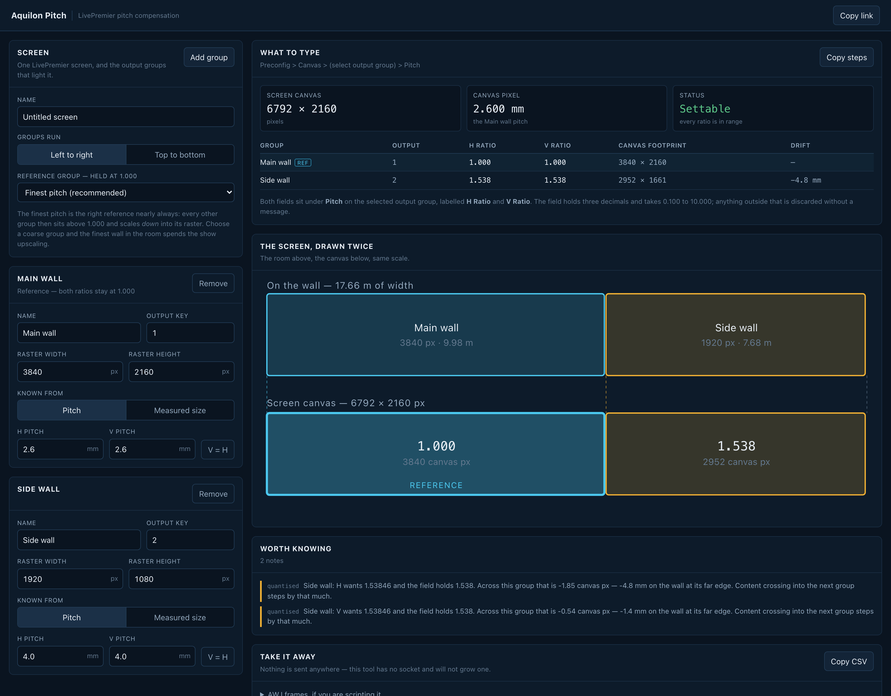

# Aquilon Pitch

> **AI-assisted project.** This codebase was created with [Claude Code](https://claude.com/claude-code)
> (Anthropic), directed and reviewed by a human author. The arithmetic isn't taken from the user
> manual. It was **driven into a running AW LivePremier Simulator 6.2.73** and read back off the
> wire: fourteen ratio/raster pairs were written to a real output's `pitchRatioH`/`V` and the
> resulting `pitchedWidth`/`pitchedHeight` recorded. Those observations are pinned as tests, and
> they're what settled the direction of the ratio, the field's range, its precision, and the fact
> that the device **floors** the canvas footprint rather than rounding it. **No pitch-compensated
> screen built from this has been driven onto real LED walls**, and nothing here has touched
> physical Aquilon hardware. The simulator runs the same `nlc-platform` web application and the
> same object model, but it isn't the switcher.

Work out the pitch compensation an Analog Way **LivePremier** needs when one screen spans LED
walls of different pixel pitches.

Type each output group's raster and its pitch (or its measured size, and let the pitch fall out).
You get the **H Ratio** and **V Ratio** to type into Web RCS, the canvas footprint each group will
take, the screen canvas that results, and the millimetres the device's three-decimal field costs
you at the far edge of each wall.

It runs entirely in the browser. There's no account and no backend, and nothing is uploaded, so a
client's set design has nowhere to leak to.



<sub>A 2.6 mm main wall and a 4.0 mm side wall on one screen: the side wall wants a ratio of 1.53846…, the field holds 1.538, and across its 1920-pixel raster that's 1.85 canvas pixels short, or 4.8 mm of real wall at the far edge, which the notes under the drawing say out loud. This is the hosted tool, with the side wall's pitch typed in over the example it opens with.</sub>

---

## The problem it exists for

A screen spanning a 2.6 mm main wall and a 5.2 mm side wall has two output groups with half the
pixel density of each other. Drive them from one canvas at 1:1 and a layer crossing the join
changes physical size the instant it crosses: same pixels, twice the millimetres.

LivePremier's answer is **pitch compensation**: a per-output-group ratio that says how much canvas
each group's raster is worth. The manual gives it four sentences:

> Some Screens using multiple outputs can have outputs with different pitches, especially LED
> video walls. […] The reference output group should use a 1:1 pitch. In Pitch, set the H and
> V ratio of the output group compared to the reference output group.

What it doesn't say is which way round the ratio goes, what the field will hold, or what happens
when the answer isn't a round number. All three matter, and all three are in here.

## Which way the ratio goes

**The ratio multiplies the group's raster to give its footprint on the canvas.** A coarser wall
gets a number above 1.000.

Verified: `pitchRatioH = 2000` written to output 1 of a running simulator, followed by
`xUpdate = true`, turned that output's read-only `pitchedWidth` × `pitchedHeight` from
1920 × 1080 into **3840 × 2160**. The 1920-pixel-wide output is handed 3840 canvas pixels and
resamples them down into its own raster, which is what you want for a wall whose pixels are twice
as far apart.

## Make the finest wall the reference

The tool defaults to it and will argue if you override it.

The ratio scales a raster **up** into canvas pixels, so the reference should be the group with the
most pixels per millimetre. Every other group then lands above 1.000, is given more canvas than it
has real pixels, and scales **down**, which is a resize a video processor does well and nobody
sees.

Pick a coarse group as the reference instead and the fine wall lands below 1.000. It's handed
*fewer* canvas pixels than it has real ones and spends the whole show upscaling, visibly, on the
best-pitch surface in the room. The tool tells you when you do it.

## What the field will actually hold

| | |
|---|---|
| Stored as | integer thousandths — `1000` is 1.000 |
| Range | **0.100 to 10.000** |
| Precision | three decimals, and no more |
| Out of range | the write is **discarded**, not clamped |
| Where | Preconfig > Canvas > *select output group* > Pitch |
| Labels | **H Ratio** and **V Ratio** — two separate fields, one per axis |

That "discarded, not clamped" line is the one worth knowing. Writing 10001 to a field holding 1001
left it holding 1001, and so did writing 99. The device says nothing at all, and the operator is
left looking at a field that still reads whatever was in it before. So this tool **refuses** an
out-of-range ratio rather than silently clamping it to 10.000 and reporting a number the switcher
will never take.

## The device floors, and it costs you a pixel

    pitchedWidth = floor(rasterWidth × pitchRatioH / 1000)

Floor, not round. That was measured four separate times:

| raster | ratio | exact | device gave | rounding would give |
|---|---|---|---|---|
| 1080 | 1.234 | 1332.72 | **1332** | 1333 |
| 1920 | 1.001 | 1921.92 | **1921** | 1922 |
| 1080 | 0.333 | 359.64 | **359** | 360 |
| 1920 | 1.234 | 2369.28 | **2369** | 2369 |

Combined with the three-decimal field, that's where the drift comes from. A 2.6 mm reference and a
4.0 mm wall want a ratio of 1.53846…, the field holds 1.538, and across a 1920-pixel raster that's
1.85 canvas pixels short, which is **4.8 mm of real wall** at the far edge. The tool reports that
number per group per axis, because it's the number that decides whether the rounding matters.

## What you get

- **The two ratios per output group**, ready to type, at the precision the field holds.
- **The canvas footprint** each group takes, computed the device's way.
- **The screen canvas** the design needs, and a plain statement when a blocked group means it
  isn't achievable as specified.
- **The drift**, in canvas pixels and in millimetres on the wall.
- **The screen drawn twice:** the walls in the room above and the canvas below, at the same scale,
  so a mapping that isn't uniform is visible rather than inferred.
- **A CSV** for the show folder, and the **AWJ frames** a script would send.

## What it will not do

**It has no socket and won't grow one.** A pitch change is a preconfig change on a live show
machine. The AWJ frames are printed for you to use as you see fit, and nothing here connects to a
switcher, which is what makes it always safe to open. If you do script it, `xUpdate` isn't
optional: writing a ratio on its own moves the command value and leaves the canvas exactly where
it was (verified).

## Running it

```bash
npm install
npm run dev
```

```bash
npm test
```

Build with `npm run build`; `dist/` is a static site, deployed as a Cloudflare Worker with
static assets (`npm run deploy`).

## The engine is meant to be borrowed

`src/lib/` has no React, no DOM, no dependencies and no imports outside itself. It's written to be
vendored into the other LivePremier tools in the fleet, the way `awj-surface`'s core is vendored
into `livepremier-plus`.

```bash
npm run build:lib      # -> dist-lib/aquilon-pitch-engine.js
```

It's one readable ESM file, unminified, with the comments intact. A minified blob in someone
else's `src/vendor/` is a dead end, and the hash manifests in the consuming repos only mean
something if a reviewer can diff actual code. `src/lib/index.ts` is the barrel that defines the
public surface, so adding an export there widens the contract.

A TypeScript consumer copies `src/lib/` itself instead and keeps the types, which works because
the directory is closed, domain types included. Nothing in it imports a path that leaves it.

`dist-lib/` is generated but **committed**, so a fresh clone can hand a consumer the file without
building first. `dist-lib.test.ts` loads the built bundle beside the source and demands the same
answers, so a stale copy fails the suite rather than silently disagreeing with every tool that
borrowed it.

## Status

**Alpha.** The device arithmetic is measured and pinned by 51 tests. The UI has been driven end to
end in a browser. What *hasn't* happened yet: nothing has run against physical Aquilon hardware,
and no screen configured from these numbers has been played out onto real LED walls and looked at.
The simulator is the same web application and object model as the switcher, and it still isn't the
switcher.

<!-- selfhost:start -->
## Run your own copy

Aquilon Pitch is a static page, so hosting it yourself is one container serving
the built files — the same files the hosted copy serves, running somewhere that
still works when the venue has no internet.

**Docker.** The image is built by this repo's `docker.yml` workflow on every
push and published as `ghcr.io/stoatworks-labs/aquilon-pitch`:

```bash
docker run -d --name aquilon-pitch --restart unless-stopped -p 8540:80 ghcr.io/stoatworks-labs/aquilon-pitch:latest
```

Or `docker compose up -d` with the [`docker-compose.yml`](docker-compose.yml)
in this repo, which maps the same port. Either way it is then at
`http://localhost:8540/`.

**Unraid.** Search Community Applications for *Aquilon Pitch* — the template is
[`templates/aquilon-pitch.xml`](https://github.com/stoatworks-labs/stoatworks-unraid/blob/main/templates/aquilon-pitch.xml)
in [stoatworks-unraid](https://github.com/stoatworks-labs/stoatworks-unraid), which is what the CA feed reads.

**Stoatworks Burrow** lists it under *Self-hosted*, with the compose file a
click away.

The `Dockerfile`, `docker-compose.yml`, `docker/` and the workflow are
generated from `fleet.json` in stoatworks-unraid. Change them there and
regenerate rather than editing them here.
<!-- selfhost:end -->

<!-- attributions:start -->
This project is built on other people's work — see [ATTRIBUTIONS.md](ATTRIBUTIONS.md).
<!-- attributions:end -->

## Licence

MIT.
